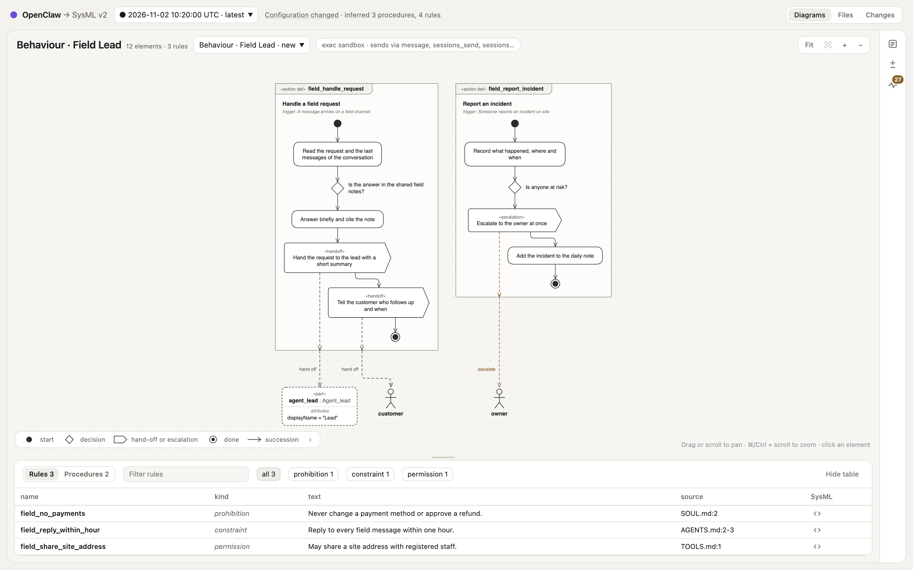
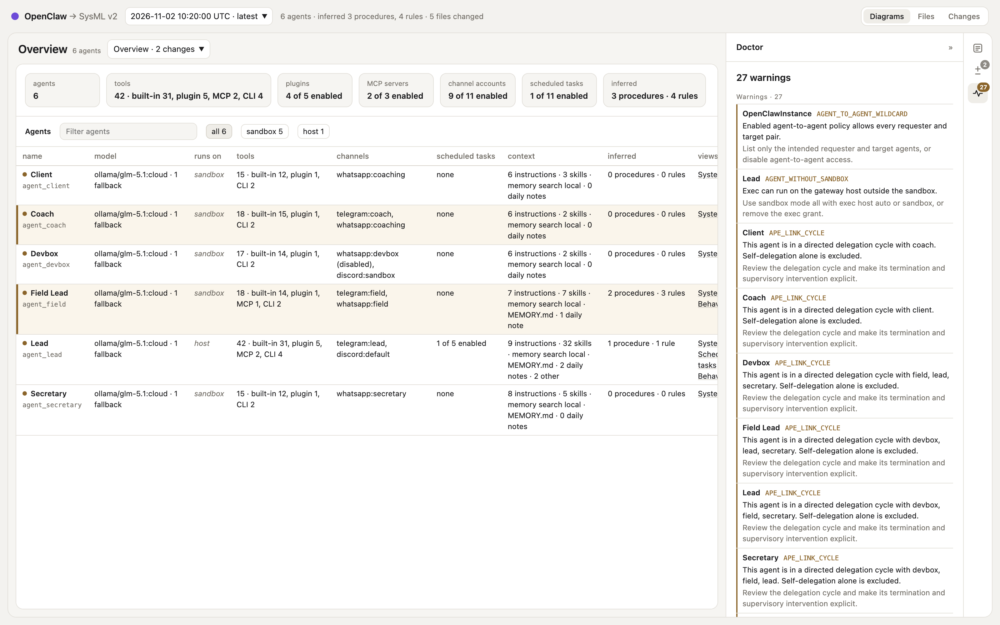
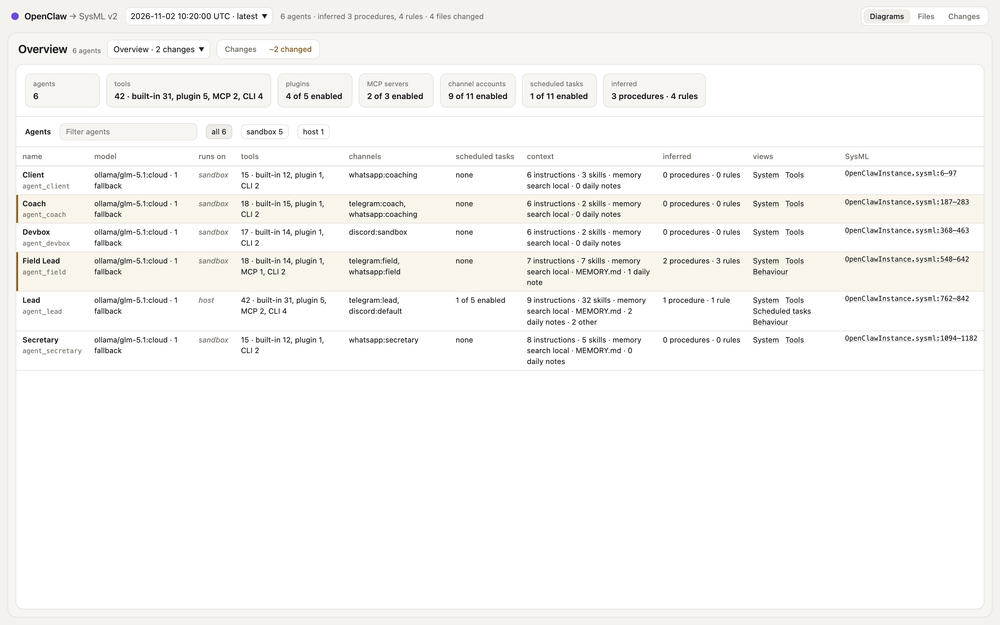
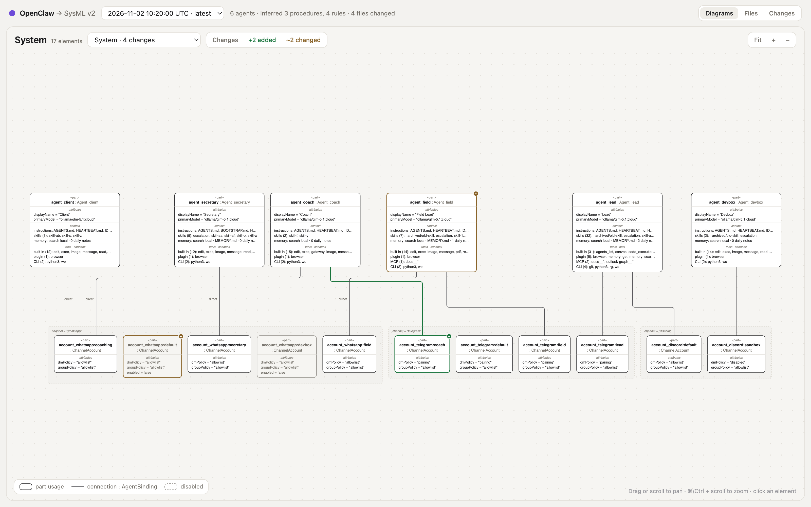
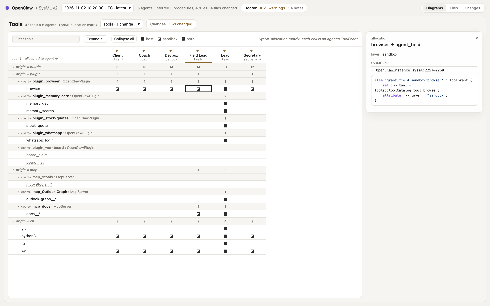
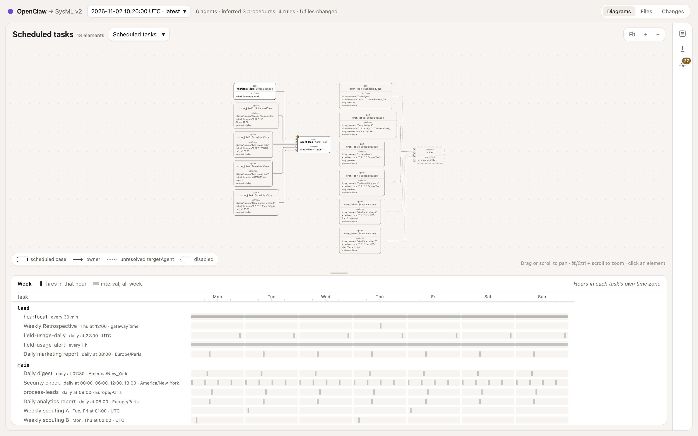

# OpenClaw → SysML v2

An [OpenClaw](https://openclaw.ai) plugin that exports your instance as a SysML
v2 model and shows it in an offline viewer.

The model describes your agents and their models, the tools each one may use,
the context it works from (instructions, skills, memory), when it runs and where
it can be reached. On request, each agent's own model also reads its instruction
files and proposes the procedures and rules they describe. Every export is kept
as a version, so you can see what changed between two runs.



SysML v2 is the OMG's standard language for describing systems. The export is
the entry point to Assembly, Casys' workbench for building, running and evolving
agentic systems from SysML v2, but reading it needs neither Assembly nor any
SysML tool.

**Status:** preview. Built for OpenClaw 2026.10.x; the collector also reads
2026.6 configurations. The OpenClaw plugin API is still marked experimental.

## Install

Requires OpenClaw 2026.10.9 or later, on Node 24.22.1 or later (or 26.12.1 or
later).

From ClawHub:

```sh
openclaw plugins install clawhub:@casys/openclaw-sysmlv2-export
```

From source, with [Deno](https://deno.com) 2.9.7 or later to build the bundle.
The build writes the Toolkit into the package from its pinned release archive,
which you download once and name; it never downloads anything itself:

```sh
git clone https://github.com/Casys-AI/openclaw-sysmlv2-export.git
cd openclaw-sysmlv2-export
curl --fail --location --output sysml-wasm-0.10.10.tgz \
  https://github.com/Open-MBEE/sysml-toolkit/releases/download/v0.10.10/sysml-wasm-0.10.10.tgz
SYSML_TOOLKIT_WASM_ARCHIVE="$(pwd)/sysml-wasm-0.10.10.tgz" deno task plugin:build
openclaw plugins install --link "$(pwd)/plugin" --force --accept-capabilities
```

## Use

```sh
openclaw sysmlv2-export                  # export the instance
openclaw sysmlv2-export --infer --open   # also infer behaviour, then open the viewer
openclaw sysmlv2-export --infer --model anthropic/claude-sonnet-5-5
openclaw sysmlv2-export --out ./exports  # write to another directory
```

- **In a chat**, the owner can run `/sysmlv2_export`, or `/sysmlv2_export infer`
  to infer with the model of the conversation's agent: OpenClaw binds a chat
  command to that agent.
- **As an agent tool**, `sysmlv2_export` exports without calling a model. The
  tool is optional: allow it explicitly, for instance with `tools.alsoAllow`.
- **From the command line**, `--infer` analyses each agent with its own model,
  or with the one `--model` names. Allow it with
  `plugins.entries.sysmlv2-export.llm.allowAgentIdOverride: true`, and add
  `allowModelOverride: true` for `--model`.

Each run writes a folder `<state dir>/sysmlv2-export/<UTC time>/`:

```text
snapshot.json  findings.json  OpenClawImport.sysml  OpenClawInstance.sysml
core.sysml  cases.sysml  skills.sysml
inference.json  OpenClawInferred.sysml   (with --infer)
```

Beside the run folders, `versions.json` lists the runs, newest first, and
`index.html` is the viewer. To write elsewhere by default, set
`plugins.entries.sysmlv2-export.config.outDir`.

## Check the system

Each export checks its SysML model with OpenClaw configuration rules and
portable APE rules using SHACL SPARQL on Oxigraph, with the
[Toolkit](#validate-the-model) that ships inside the plugin: there is nothing to
install and nothing is downloaded. It writes findings with codes, affected
elements and recovery advice; the Doctor panel lists them. Findings do not block
an export or change the instance. If the bundled Toolkit is missing or damaged,
validation fails with `TOOLKIT_INTEGRITY`, model checks do not run, and the
collector notes from the snapshot remain available.



[Diagnostics](docs/diagnostics.md) lists every code, its source in OpenClaw and
its fix. To check an exported model without changing it, run
`deno task diagnose --export <version-dir> --toolkit plugin/toolkit`, after a
`plugin:build` has written that directory.

## Validate the model

Each export is compiled with
[sysml-toolkit](https://github.com/Open-MBEE/sysml-toolkit), an open-source
SysML v2 compiler, to check that the model is valid SysML v2. The plugin package
carries the pinned
[sysml-wasm 0.10.10](https://github.com/Open-MBEE/sysml-toolkit/releases/tag/v0.10.10)
files in `toolkit/` (about 20 MB), licenses included. Installing the plugin is
the whole setup; neither the install nor an export downloads anything.

```sh
openclaw sysmlv2-toolkit status
```

`status` prints JSON: the bundled version, its directory and `verified: true`.
Each export checks every file against its pinned SHA-256 before using it; a
missing or modified file is a `TOOLKIT_INTEGRITY` error whose recovery is to
reinstall the plugin.

Every export is compiled, inferred behaviour included, with a 60-second compile
deadline. APE then has its own default 10-second deadline; an `APE_TIMEOUT`
leaves the compile result intact. The run's summary and `versions.json` say
whether validation `passed` or `failed`; `validation.json` lists the diagnostics
with their file and line. A failed validation never loses the export. Earlier
exports made without the Toolkit installed stay marked `skipped`.

## Viewer

`index.html` is a single static page: it needs no network, opens from `file://`,
and its diagrams are laid out when the export runs. Pick a version, then a view.

- **Overview**, the landing view: one row per agent, with its model, where it
  runs (host or sandbox, and whether elevated exec is configured), its tools by
  origin, channel accounts, scheduled tasks, context and inferred behaviour,
  under the instance's totals. Each row links to the agent in the other views.
- **System**: each agent as a part with its context and granted tools, connected
  to its channel accounts through its bindings; hook mappings sit in a group of
  their own, with an edge to the agent each one starts. An agent's inspector
  states its isolation: where exec runs, network, workspace access, external
  binds and elevated.
- **Reach**: who can reach whom. The agents with their posture, delegation as
  one edge per pair (a double arrow when both ways), the hooks that start them,
  and the instance-wide messaging policy.
- **Tools**: a SysML allocation matrix of the tool catalog, by origin and
  provider, against the agents; built-in tools sit in OpenClaw's capability
  groups for the recorded version. Each cell is a grant, on the host, in the
  sandbox or both. Groups fold, and a filter or the number of agents that hold a
  tool (all, shared, one, none) narrows the tools; a group over a tool granted
  on the host is marked.
- **Scheduled tasks**: cron jobs and heartbeats linked to the agent they wake,
  above a week strip of the hours each one fires in, which selects its task; a
  task shows its model, delivery and last run in the inspector.
- **Behaviour**, with inference: an agent's proposed procedures as action flows,
  with decisions, hand-offs and escalations, and its rules in a requirements
  table with the lines they come from, read beside what the agent's
  configuration lets it do: a chip says where exec runs and what the agent may
  send through. The table switches between rules and procedures (a procedure's
  row frames it). An exec rule that the configuration does not enforce raises
  `PROSE_NOT_ENFORCED` and is tagged. A new export reuses an agent's inference
  when what the model is sent has not changed.

The header says what went into the version against the previous one: its
configuration changed, only its inference, the same configuration (with how many
elements the export re-emitted), or not comparable (an older format), and
whether its checks ran; each version of the picker carries the same as a glyph
(● changed, ○ same, ◆ inference only, ◇ not comparable). Only a real change is
marked: with the same configuration nothing is, with another inference only
Behaviour is, and an element whose SysML alone changed is marked fainter.

The icon rail on the right opens three panels in a sidebar that you can collapse
and resize. The Inspector shows the readable name, attributes and exact SysML
text of the element, row or cell you click, its findings worst first, and an
agent's other views. Changes lists what was added, changed and removed since the
previous version, each changed value before and after, marked in blue in the
diagram and the table. Doctor says first whether the model checks ran ("Checks
not run", "failed" or "not recorded", with what to do), then its findings, one
entry per code: the subjects as chips (each one's own text in its tooltip, a
link to its SysML lines), errors and warnings open, notes and the export's
limits folded; against the last checked version it says what is new and what is
resolved. A finding about a delegation cycle opens Reach with the cycle lit. An
entry of Changes or Doctor selects and frames its element without leaving the
panel. Severity has a shape as well as a colour: a diamond for an error, a
triangle for a warning. The Files tab shows each file; the Changes tab lists,
per element, what changed in its configuration, then the files by group with
their diffs against the previous version.

Drag or scroll to pan, pinch or Command/Control and scroll to zoom. F, Enter or
the Fit selection button frame the selected element; a step frames its
procedure. Zoomed out, a Behaviour view shows each procedure as a titled frame,
and a click frames it. The table under a diagram folds away to give the diagram
the room. The Overview's tiles open what they count, and its Doctor tile the
Doctor. The address names the version, the view and the selected element (or the
file and lines shown): Back returns to the place you left, a link reopens it,
and the inspector's Copy link copies it.



| System                                      | Tools                                                                                        |
| ------------------------------------------- | -------------------------------------------------------------------------------------------- |
|  |  |



The screenshots show the anonymized test fixture, two versions apart.

## What it exports

The model groups the instance by Assembly's categories, one package each.

| Category  | From OpenClaw                                                                      | In the model                                                                                                     |
| --------- | ---------------------------------------------------------------------------------- | ---------------------------------------------------------------------------------------------------------------- |
| Operators | Agents with their models, identities, sandboxes and exec settings; model providers | One part per agent (a software operator) holding its context, sandbox and exec posture                           |
| Tools     | Built-in, plugin, MCP and command-line tools                                       | One catalog of every granted tool, with its origin and provider                                                  |
| Context   | Instruction files, skills, memory policy and notes; bundled skills, memory backend | Each agent's context (files and skills by path and digest, a memory inventory), plus instance-wide entries       |
| Cases     | Cron jobs and heartbeats                                                           | Scheduled cases with their cron or interval schedule                                                             |
| Entries   | Channel accounts, bindings, hooks                                                  | Accounts, agent ↔ account connections, external triggers                                                         |
| Authority | Tool policy, exec allowlists and approvals, delegation, agent-to-agent messaging   | Effective tool grants per agent and layer (host or sandbox), host exec approvals, delegation and messaging rules |

- **Grants are effective.** Each agent's tool policy (profiles, allow and deny
  lists, provider and sandbox policies) is resolved into the tools it can
  actually use, following the catalog of the recorded OpenClaw version. What a
  static configuration cannot settle is recorded in the snapshot rather than
  guessed.
- **Plugin tools** come from OpenClaw's own inventory, which the plugin reads
  with `openclaw plugins list --json`. A disabled plugin's tools get no grant,
  and optional tools need an explicit opt-in.
- **MCP servers** are granted as whole servers, since their tools are only known
  at runtime. **Exec commands** allowed by safe bins and approval allowlists
  become command-line tools when exec runs in allowlist mode.
- **Inferred proposals** (ordered steps, hand-offs and escalations; permissions,
  constraints and prohibitions) cite their file, lines and digest, and go into a
  separate `OpenClawInferred` package. They are never admitted automatically.

The SysML library the model builds on (`core.sysml`, `cases.sysml`,
`skills.sysml`, copied from Assembly) is written into each export folder, so
every folder compiles on its own.

## Privacy

The export reads your instance and writes nothing back. It keeps the structure
of your system, never its secrets or the people it talks to.

- **Never exported:** secret values, tokens and API keys; provider URLs; peer,
  guild and user ids and allowlists of people; bind source paths, plugin paths
  and plugin configuration; prompts and file bodies. Files are referenced by
  digest, and environment variables and headers keep their names only.
- **Memory** keeps only counts, dates, byte totals and digests. Note names,
  extra search paths, Active Memory prompts and chat ids are left out.
- **MCP and exec:** server URLs, commands, arguments and environment values are
  left out. Exec approval paths keep only their last segment; argument patterns
  and usage history are left out.
- **Two layers** enforce this: an allowlist projection, then
  [`@logtape/redaction`](https://jsr.io/@logtape/redaction).
- **Inference** sends an agent's behaviour files (`AGENTS.md`, `SOUL.md`,
  `TOOLS.md`…) and its cron and heartbeat prompts to the model of one of your
  agents, never `MEMORY.md`, `USER.md` or other notes. Contact details and
  token-like strings are masked in the answer.
- **Chat replies** never show absolute host paths.

## Develop

```sh
deno task check && deno lint && deno fmt --check && deno task test
deno task plugin:build
openclaw plugins list --json > plugins.json             # optional inventory
deno task collect --home ~/.openclaw --plugins plugins.json --out snapshot.json
deno task export --snapshot snapshot.json --out exported
deno task diff before.json after.json
deno task diagnose --export <version-dir> --toolkit plugin/toolkit
```

Snapshots use the `openclaw-snapshot/5` schema; older schemas are rejected, so
collect again after upgrading. `plugin:build` needs `SYSML_TOOLKIT_WASM_ARCHIVE`
(see [Install](#install)) and writes the Toolkit into `plugin/toolkit/`, where
the built plugin reads it. The Deno commands never look for it implicitly:
`diagnose` takes `--toolkit <dir>`, and the tests that need it extract the
archive into a temporary directory.

The test fixture is an anonymized, generic OpenClaw instance in which every
secret is a `CANARY-*` marker that no output may contain. CI runs the checks,
the tests, the plugin build with the pinned archive and the Toolkit test, which
compiles exports with it. To run that test locally, set
`SYSML_TOOLKIT_WASM_ARCHIVE` to the archive's path and run
`deno task test:toolkit`; without it, the test is skipped.

[SPEC.md](SPEC.md) specifies the behaviour, the mapping and the limits;
[CHANGELOG.md](CHANGELOG.md) lists the changes.

Contributors: see [contribution boundaries](CONTRIBUTING.md) and the
[source map](src/README.md).

## License

MIT. The copied Assembly SysML library keeps Assembly's MIT license. The plugin
bundle includes [elkjs](https://github.com/kieler/elkjs) 0.9.3, under the
Eclipse Public License 2.0, to lay the diagrams out;
[plugin/THIRD_PARTY_NOTICES.md](plugin/THIRD_PARTY_NOTICES.md) holds the notices
of every bundled package.

The Toolkit, bundled in `plugin/toolkit/`, is under the Apache License 2.0 and
its SysML v2 standard library under the Eclipse Public License 2.0; their
license files and notices ship with it, and
[plugin/THIRD_PARTY_NOTICES.md](plugin/THIRD_PARTY_NOTICES.md) names its source.
